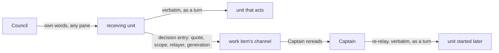

# Authority

Who may decide what, how a decision travels from the Council to the unit that acts on it, and what
the fleet does while a decision it needs has not been given. Roles and the other rules are in the
[model](./model.md); terms are in the [glossary](../glossary.md). The rules each unit enforces are in
[`authority/`](../authority/README.md).

## Where authority comes from

Authority comes from the Council and nowhere else. An automaton never creates it, widens it, or
reuses it past what it covers. Harnesses already keep an agent from acting beyond its instructions
most of the time; the fleet's part is to make the Council's larger grants actually reach the units
that need them, and to keep the work moving when a grant is missing.

Most work needs no grant. Taking an issue in, planning, spawning Pods, writing code, opening pull
requests, and running gates are dispatch: a unit does them on an order. A grant is needed only for a
**ratification-class** action: a merge to a protected branch, a human-attributed verdict, a publish,
a history rewrite, a settings or secrets change, a widened delegation, or a minted owner identity.
Widening the work itself, taking on work the Council did not ask for, needs one too.

## Grants

The Council grants at the scope it chooses:

| Scope | Example | Covers |
|---|---|---|
| Mission | "Land everything in the retry mission." | The mission's pull requests and its sub-missions', within the words, in any ship |
| Action | "Approve." in answer to one decision-request | The one action, target, and revision the request named |

A grant covers what its words cover, read from the request they answer, and nothing implicitly
beyond. A merge grant covers each pull request of the work it names and is spent per merge.

**Pre-approval.** The Council can also cover work that does not exist yet, by setting a bound:
"follow-ups under this mission that don't change the public API", or "any fix the mission needs
in cyberlegion". When new work appears, the Captain decides whether it falls inside the bound. That is
judgment, so it stays with the Captain at the high tier. Each use is recorded in the channel's
metadata with the work item and the bound it fell under, so the Council can review every one. Work outside the bound goes to the
Council as a decision-request.

## How a grant travels

1. **Relay.** The unit that receives the Council's words passes them, verbatim and as a turn, to the
   unit that acts, unless it is that unit.
2. **Record.** The receiver writes a decision entry on the work item's channel: the quote, its scope,
   who relayed it, and the lease generation. A grant goes on the channel of the mission it names. The entry is the audit record, and the source for re-relay.
   Authority records live in cynapse, in the channel and its metadata, never on a public tracker
   such as GitHub Issues or Asana.
3. **Re-relay.** A grant often has to reach a unit that did not exist when the Council spoke: a
   Coordinator started for the next pull request, a session restarted after a crash or a lease
   takeover, a session whose context was compacted and can no longer quote the words from its own
   turns. The Captain re-relays the grant to that unit, verbatim from the decision entry and as a
   turn. The Captain answers for the re-relay, and the re-relay is itself recorded. What triggers
   it: a unit that reaches a step needing a grant it does not hold asks its Captain first, with a
   decision-request. If a recorded grant covers the step, the Captain re-relays it; if none does,
   the Captain adds the request to its list for the Council.

Re-relay has limits:

- **Only a Captain re-relays**, and only to units in its own ship. For a grant on a parent mission, each ship's
  Captain re-relays to its own units from the mission channel. A Coordinator never re-relays to
  itself from a record: that would be a low-tier unit acting on content it fetched.
- **Verbatim only.** The quote is copied from the entry, never paraphrased or summarized. The scope
  is read from the words, never from the entry's scope field.
- **Never wider.** A re-relay passes on exactly what the entry records and nothing adjacent.

Re-relay is a deliberate loosening. A recorded entry is content, and elsewhere content never carries
authority. Here a Captain turns a recorded grant back into a turn, on its own judgment and its own
name. That makes a wrong re-relay attributable, not impossible: nothing in the fleet yet stores a
grant that an agent cannot edit, and none is planned: cyberlegion#10 was closed in favour of relaying
the Council's own words (cyberfleet#62). If such a store is ever built, units can verify a grant
themselves and re-relay becomes unnecessary.

## When a grant is missing

The Council is often away, and work keeps arriving that its grants do not cover. The Captain's job is
to get as much done as the grants allow, and to make the Council's next answer unblock as much as
possible.

**The work is in scope, but one step needs a grant.** Typically a merge with no delegation, or a
publish. The Captain lets everything up to that step proceed: the Pods implement, gate, open the
pull request, and get it clean. The step itself is held. Work that depends on the held step keeps
moving where it makes sense, for example by stacking on the held branch so that everything lands
in order through the clean bar when the grant comes. How stacking interacts with merge order and
the clean bar is still to be investigated; until then, the Captain judges case by case.

**The work itself is outside every grant.** New work the Council did not ask for, or a pre-approval
bound it does not fit. The Captain files the issue, so the work is visible and ready to take in, but
starts no Pods on it. Spending on work the Council has not agreed to is the widening this section
exists to prevent.

**Reordering.** The Captain plans around the gaps: covered, independent work moves to the front;
work blocked on a held step waits behind it; and between two covered items, it prefers the one that
unblocks more once the Council answers.

**Asking.** The Captain batches its decision-requests into one list for the Operator to put to the
Council, ordered by how much work each answer unblocks. Each request names the action, the target,
and the revision, so one word answers it. A headless Captain and Coordinator batch the same list as
needs-input and exit.

## Limits

- **Attributable, not unforgeable.** Injected text carries no verified caller identity, and records
  are files an agent can edit. A unit that forges a record defeats the audit; the design makes a
  wrong relay traceable, not impossible.
- **A receiver cannot detect over-relay.** It has nothing to check a relay against, so the guard is at
  the sender and in the audit, never at the receiver's gate.
- **A ruling never overrides red.** No grant makes a pull request clean. A grant decides whether a
  clean pull request may land; the clean bar decides whether it is clean.
