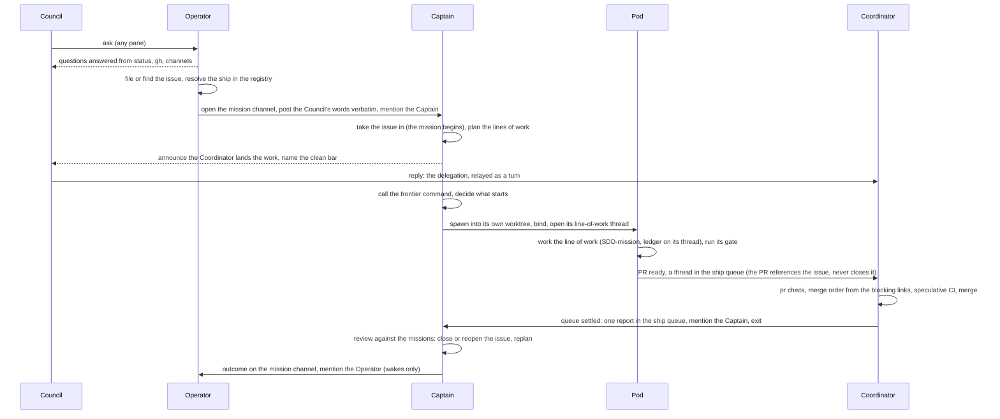
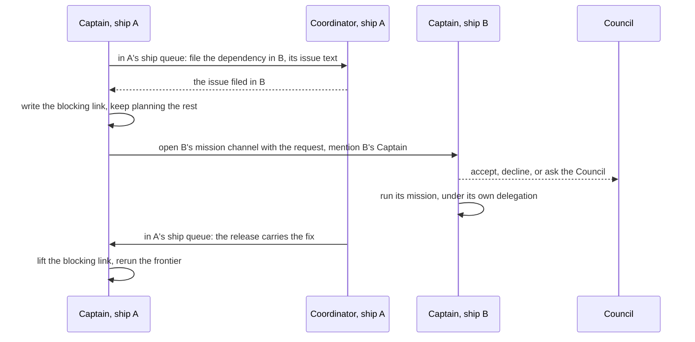

# Lifecycle

How one piece of work travels from the Council's ask to merged code and a closed issue, and how the
same path stretches when the work spans ships. Roles, places, and rules are in the
[model](./model.md); terms are in the [glossary](../glossary.md).

## One mission, end to end

### 1. The ask

The Council talks wherever it is: the Operator's seat, a ship's remote pane, a Captain's pane, or
the Coordinator's pane. A question is answered where it lands, from `cyberfleet status`, `gh`, and
channels, without waking a Captain. Work goes to the target ship's Captain, and whoever brings it
creates the mission's channel. Outside the Captain's pane that is the Operator: a remote pane or a
Coordinator's pane calls it with the Council's words.

The Operator files the issue, or finds the one the Council named, and resolves its ship from the
ship registry by the issue's normalized remote. A repository that is not cloned on this machine is
the Council's call: the Operator asks, suggesting a path from where the known ships sit
(`~/code/<owner>/<repo>` when they share that layout), then clones and registers the ship. It then
opens the mission channel, keyed by the issue, posts the Council's words verbatim as its first entry,
and mentions the Captain (`cyberlegion/captain`). A request starts the Captain through its lease if
no session is acting as it. The ship's remote pane is never invited.

Talking in the Captain's own pane is a deliberate choice to spend the high tier. There the Captain
brings the work itself: it creates the mission channel with the Council's words, and the Operator is
not a member.

### 2. The Captain takes it in

The mission begins when the Captain takes the issue in. Taking it in, scoping it, and later closing
or reopening it are writes fenced by the Captain's lease. Anyone may file an issue; only the Captain
decides to take one in.

The Captain plans the mission's lines of work and the blocking links between them, written to the
ship's one home for links (the tracker, or a cynapse state record). It calls the frontier command for
the work whose blockers are all closed, and decides what to start, in what order, and at what tier.
The deterministic collision checks (blast estimate, node, file, and region) are commands it calls;
whether to run two colliding lines in series is its decision. It spawns each Pod into a worktree
provisioned through the runtime, binds it under the ship's Captain handle, and opens the line of
work's thread on the mission channel. It manages Pods and never works inside one.

### 3. The delegation

Whoever takes the request announces who will land its pull requests (the ship's Coordinator, or
each Pod under the ship's landing setting), and names the clean bar. The Council's reply is the merge
delegation, for the mission and its sub-missions as its words say. It reaches the Coordinator as a
relay, verbatim and as a turn, like any other order. The audit record on the mission channel is not
the delegation: a Coordinator that reads it there is reading content.

### 4. The work

Each Pod carries one line of work, today through an SDD-mission, and works in that line's thread on
the mission channel. The thread holds the SDD-mission's ledger, until cynapse has a thread type of its
own. Where the mission has a gate, the Pod opens a gate thread and spawns a cold judge into it; the
Captain takes no part, and the outcome posts back to the mission channel.

A Pod that hits the limit of its brief escalates to the Captain in a thread on the mission channel,
mentioning it: the fix outgrows the mission, the spec is wrong, a design choice is beyond its brief,
or the judge keeps failing it. An escalation needs an answer, so it starts the Captain if none is
running. The Captain rules, and the ruling is recorded on that mission's channel.

### 5. Landing

When its line of work is done, the Pod opens a pull request that references the issue without
closing it, and posts "PR ready" as a thread in the ship queue, which it joins by posting. The
Coordinator counts the open pull requests of each delegated request, up when a Pod opens one and down
when it merges or closes. The Coordinator joins no mission channel: the landing talk for each pull
request stays in its queue thread.

The Coordinator lands each pull request when `cyberfleet pr check` passes, in the order the blocking
links give, behind speculative CI and its lease (`service verify` before `gh pr merge`). It acts on
the command's exit status and never judges "clean enough". Between events it blocks on a command
that returns when there is news, rather than polling. In a ship whose landing setting gives landing to
Pods, each Pod does the same for its own pull request, under the same lease and the same bar, and no
Coordinator starts.

What goes wrong splits by kind:

| Failure | Handled by |
|---|---|
| A text conflict | The Coordinator tells the Pod to rebase |
| Red CI the pull request caused | The Coordinator tells the Pod to fix it |
| A review comment within the mission's scope | The Coordinator tells the Pod to address it |
| Two pull requests that conflict in meaning | Escalated to the Captain on the ship queue, since they may belong to different missions |
| A review asking for a change of scope, red that survives the Pod's fixes, a bisect culprit, a stuck Pod | Escalated to the Captain in the pull request's queue thread |
| A clean pull request with no delegation in the Coordinator's own session | A decision-request to the Council, through the Operator |

A ruling never overrides red. It settles the question that held the pull request, which then goes
back through the clean bar.

### 6. The review

When the count reaches zero, the queue has settled. The Coordinator posts one report of what landed
in the ship queue, mentions the Captain, and exits. The report asks for the Captain's review, so it
starts the Captain if none is running. The Captain reviews what merged against its missions and the
project: it closes the issues that are done, reopens one that needs a follow-up the request covers,
files new issues for work the request did not cover, and calls the frontier command again to start
Pods on work that became ready. It posts each mission's outcome on the mission channel and mentions
the Operator; an outcome is a notification, so it wakes a running Operator and starts none. The
mission ends when the Captain closes its issue.

This review is the outer loop. It runs once per settled queue, not once per merge, because it is
judgment and judgment runs at the high tier.

## When a mission has sub-missions or dependencies

A Captain adds sub-missions to break work down: the mission is done when its sub-missions are done.
Work that needs another ship is a dependency: a mission in that ship that blocks the requesting
mission. A mission belongs to whoever holds its issue.

- **Adding sub-missions.** The Captain decides what they are and checks them against the Council's
  words. A grant on a mission covers its sub-missions in any ship, within its words or a
  pre-approval; a sub-mission that adds work goes back to the Council first. The Captain posts the
  tracker changes to its ship queue, and the Coordinator executes them as commands
  (`cyberfleet mission add-sub`) and sends an underspecified request back rather than filling the
  gap.
- **Another ship.** A blocking mission in another ship is not covered by the grant on the mission it
  blocks. It needs the Council's words naming it, or a pre-approval such as "any fix #42 needs in
  cyberlegion". The other ship's Captain accepts it as its own mission, declines it, or asks the
  Council, and its merges wait for the Council's words. To grant once over a cross-ship effort,
  make it a mission with sub-missions.
- **Blocks.** The requesting Captain's Coordinator files the issue in the other ship. The Captain
  then writes the blocking link itself (`cyberfleet mission block --on <issue>`), opens the other
  ship's mission channel with the request, mentions that ship's Captain, and keeps planning
  everything else. The requesting ship's Coordinator watches for the fix and posts to its ship queue
  when it lands, usually at the release that carries it, because ships consume each other as
  published packages; at the issue's close only when the dependency is consumed from source. The
  Captain lifts the link and calls the frontier command again.
- **Closing.** When a mission's sub-missions have closed, its Captain's Coordinator closes it and
  reports once to the Captain (`cyberfleet mission close`). A blocking mission is closed by its own
  ship's Captain, never by the requesting ship.
- **Disputes.** Two Captains that disagree settle it themselves on a dispute thread: one position
  and one rebuttal each, then standing rules, then a Mediator's brief. A dispute they cannot settle
  escalates to the Council, and only the Council binds two ships.

## Without the Council

Headless runs keep the same split: a headless Captain and a headless Coordinator, never one loop
doing both. A headless Coordinator merges only under a delegation the Council gave before leaving,
or under a standing rule; anything else is batched as needs-input. What a Captain does while a
grant is missing is in [authority](./authority.md#when-a-grant-is-missing). Each headless start is a
fresh session that rereads the channels of its open missions, its ship queue, and the decisions since
its last lease generation, acts, and exits.
