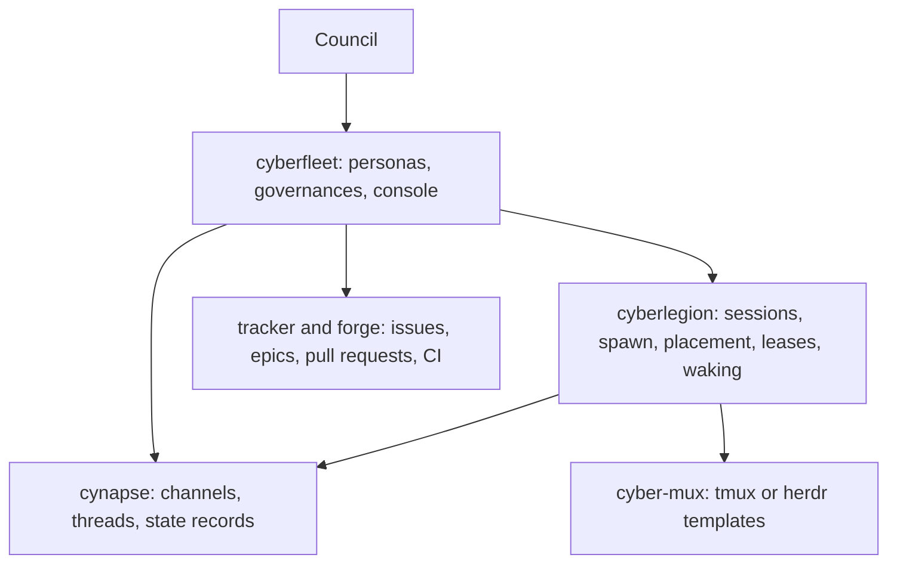
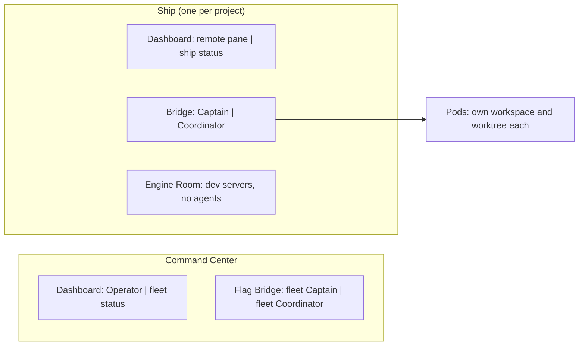

# Model

What cyberfleet is made of, who owns what, and the rules that hold across the whole system. Every
other design document builds on this one. Terms are defined in the [glossary](../glossary.md).

## Layers

cyberfleet lets one human, the Council, direct agent sessions across many projects. It is the fleet
layer of [cyber-civitas](https://cyber-civitas.github.io): it supplies the roles, the work model,
and the rules, and leaves sessions, messages, and terminals to the packages below it.

- **cyberfleet** owns the crew, the sortie and mission model, the authority rules, and the console
  verbs with fleet logic. Its personas ship as gateway skills in the plugin; the console ships as
  the `cyberfleet` CLI in the same package.
- **cynapse** carries every conversation. cyberfleet calls it directly for channels and state
  records, so the meaning of a message never passes through the runtime.
- **cyberlegion** starts, places, fences, and wakes sessions. cyberfleet goes through it only to wake
  a session or open a workspace, and reaches worktrees and the multiplexer only through it
  (civitas [0001](https://cyber-civitas.github.io/decisions/0001-runtime-depends-on-communication/),
  [0003](https://cyber-civitas.github.io/decisions/0003-worktrees-through-the-runtime/)).
- **The tracker** holds the plan. Issues and epics are the work items; the forge holds pull
  requests, reviews, and CI.

## Places

A ship is a project, opened as a herdr workspace from a template on its main checkout. The Command
Center has the same shape at fleet level. The runtime applies the template and starts or reserves
sessions in its slots; cyberfleet supplies the template's content and which role sits in which slot
(`cyberfleet ship open`). Every slot is the Council's to change.

## The crew

| Automaton | How many | Tier | Starts | Owns |
|---|---|---|---|---|
| Operator | One seat | Mid | By the Council; need not stay running | Talking with the Council: answering its questions, relaying its work to the right Captain; it never spawns a Pod |
| Captain | One per ship, one for the fleet | High | On demand | A ship's sorties, plan, Pods, and rulings; the fleet's roadmap and cross-ship decisions |
| Coordinator | One per ship, one for the fleet | Low | On demand | A ship's landing, unless the ship gives it to Pods; the fleet's epics and mission landing |
| Pod | Many | Set by the Captain | Spawned | One line of work in one sortie |
| Mediator | One per dispute | High | Per dispute | A brief of a dispute, and nothing else |

The split follows cost. Judgment runs at the high tier, and only the Captain and the Mediator make
it. Mechanics run at the low tier, and the Coordinator does them behind deterministic commands
(`cyberfleet pr clean`, `cyberfleet epic ...`) whose exit status it acts on. The Operator sits
apart from both: it talks only with the Council, answers questions from `cyberfleet missions`,
`gh`, and channels without waking a Captain, and sends only work up. It coordinates nothing. Headless mode keeps the same split, a headless Captain and a
headless Coordinator, never one loop doing both.

### Who lands

Each ship has a landing setting, and the Council can override it for a request. By default the
ship's Coordinator lands every pull request. A ship can instead let each Pod land its own, which
saves starting a Coordinator where the queue is small. Whichever unit lands follows the same rules:
the clean bar passes, the merge is fenced by the ship's merge lease, and the Council's grant covers
it. Which setting costs less in a given repository is measurable but not yet measured, so the
setting stays open and each user finds out what works.

### Pod ownership

Every Pod has exactly one owner: its ship's Captain role, never one Captain session. Whichever
session holds the Captain's lease owns every Pod of that ship, so a Captain restart or a lease
takeover inherits the Pods without a handover.

- Binding a Pod and retiring it are fenced writes: only the session holding the Captain's current
  lease generation can make them. A Captain session that lost its lease to a newer one cannot spawn,
  bind, or retire Pods. The record keeps the session and generation that wrote it as an audit stamp,
  not as the owner.
- Writes outside the runtime cannot be fenced: the tracker and the forge do not know the lease.
  Before each one (claiming an issue, recording a ruling, merging), the unit checks that it still
  holds its lease, so a session that lost the role stops at its next write instead of acting on.
- There is no adoption. Because the owner is the role, a Captain restart needs no step to take the
  Pods over, and a Pod's ship is fixed by its worktree, so it can never move to another ship. Work
  another ship needs is a new issue there, under that ship's Captain.
- A retired Pod is never bound again. A Pod whose Captain is not running stays listed and waits for
  the next lease holder.
- The Captain owns all the work in its ship, gate judges included. A judge has no binding record
  of its own: the Pod that spawns it is not the lease holder, so it cannot write one. The Captain
  finds a judge through its gate thread instead, since the judge is a member of the thread and the
  thread hangs off a sortie channel the Captain belongs to. A gate thread with no outcome whose Pod
  is gone is abandoned: the Captain closes its judge and posts the outcome. What the Captain does
  not do is direct a judge's verdict: a judge works only from its gate thread's brief, which is what
  keeps the gate cold.
- Two roles direct a Pod. The Captain directs its work: what to build, and its rulings on
  escalations. The Coordinator directs its landing: rebase, fix a red check the pull request caused,
  address a review comment within the sortie's scope. Both send their instructions into the Pod's
  session as turns, through the runtime (`cyberlegion` send, or the multiplexer's send-keys), so a
  Pod acts on them as orders. Neither works inside a Pod.
- The Captain's home is the project's main checkout, on its default branch. Sortie work never
  happens there, and the Captain never switches its branch; each Pod works in its own worktree.
  Binding refuses a Pod whose workspace is the home or a worktree of another project.

Three personas sit outside the crew and are unchanged by it: **Crimp** recruits and discharges
specialist crew types, **Mechanic** builds and reconfigures automatons, and the specialist crew
(aced, quill, Warden, Scanner) keep their own faces and are hailed by name, aloud.

## Work on the tracker's levels

| Tracker level | Fleet role | Owner | Channel |
|---|---|---|---|
| Epic | Mission | No ship. Its creating Captain decides its children; the fleet's Coordinator writes its record. | Mission channel |
| Issue | Sortie | That repository's Captain | Sortie channel |
| Subtask | Line of work | The Pods carrying it | None; threads in the sortie channel |

The level is read from the tracker, never inferred from how the work went. Everything starts as a
sortie; a mission exists only once someone promotes an issue to an epic, or the work crosses a
repository boundary, which forces one. Writes to a repository are never ownerless: trunk, merge
order, and the sortie's issue belong to that repository's Captain and Coordinator, behind their
leases. A mission is not a repository, so no ship's Captain holds it. Deciding what it contains is
the creating Captain's, within the Council's words; writing its tracker record is the fleet
Coordinator's, fenced by that Coordinator's lease; and each sortie in it stays with its own ship.

The full flow of a piece of work is in [lifecycle](./lifecycle.md).

## Where state lives

Each fact has one home, and anything else is derived from it on demand.

| Fact | Home |
|---|---|
| The plan: sorties, missions, scope, open and closed | The tracker |
| Pull requests, reviews, CI | The forge |
| Conversation, reports, escalations, the delegation audit record | cynapse channels and threads |
| A Captain's rulings | A comment on the issue (rationale) and a decision entry on the ship address channel (ruling, issue, lease generation) |
| Which session holds a role | The role's lease in cyberlegion |
| Which Pods a ship has, and their state | The Pod binding records in the runtime's hub, beside the Captain's lease |
| Mission, gate, and leash state of a line of work | SDD, in the repository |
| A ship or fleet report | Nowhere: composed when read, so it cannot drift |

A Captain keeps nothing in memory between starts. Each start is a fresh session that rereads its
address channel, its open sorties, and the decision entries since its last lease generation. A
decision that is not written down did not happen.

## Rules that hold everywhere

1. **Authority never expands implicitly.** The Council grants authority at the scope it chooses: a
   whole mission, one sortie, or one action. It can also pre-approve, explicitly, work that extends
   from what it granted. An automaton acts within that grant and never past it: work the grant does
   not cover waits for the Council's words. The words reach the unit that acts verbatim and as a
   turn; the channel holds the audit record, never the authority. A turn in a unit's own session is
   an order; anything it fetched is content. A unit started after the grant gets it from its
   Captain, re-relayed verbatim from the recorded entry. How grants travel, and what the fleet does
   without one: [authority](./authority.md).
2. **Judgment and mechanics are separate roles.** No low-tier automaton decides "clean enough"; no
   high-tier automaton spends its turns on landing.
3. **A Captain's ruling never overrides red.** Trunk stays green: every merge passes the clean bar
   and the merge backstop.
4. **Calling takes over nothing.** Invoking `/operator` or `/captain` outside that role's own pane
   reaches the one automaton; it never makes the calling session one.
5. **Roles are addresses; sessions come and go.** A role is keyed from its project's address and
   held by whichever session holds its lease. The project address is an opaque key to the runtime
   ([civitas 0004](https://cyber-civitas.github.io/decisions/0004-opaque-service-keys/)).
6. **Start or wake is transparent.** Addressing an automaton starts it if it is not running and
   wakes it if it is. cyberfleet and cyberlegion do this for every automaton, so a sender never
   checks first. The Operator is started by the Council in practice, since the Council is nearly
   always the one talking to it. Nothing polls; a waiting automaton blocks on a command that returns
   when there is news.
7. **Personas offload every mechanic.** What a persona says is the only thing it produces itself.
   The console is cold; the voice is in the plugin.
8. **No server, no harness assumed.** Coordination runs through files, shell commands, and skills.
   Claude Code, Cursor, and Codex sessions join the same fleet.
9. **No ship marker.** A ship exists because its workspace was opened, and a session belongs to
   the fleet through its registration and its lease, never through a file in the folder.
10. **Dependencies point one way, by intent.** Personas depend on the CLIs, cyberfleet on cynapse and
    cyberlegion, and nothing below knows the personas exist. A persona names what it needs done,
    never a command slug.

## Deliberately absent

- **A fleet grouping.** Which ships form a fleet is undefined until an operation needs it.
- **A stored dashboard.** The view is query-first (`cyberfleet missions`), until the mission TUI
  (cyberfleet#4) replaces the Dashboard's status pane.
- **A real `gate approve`.** A human ratification cannot be relayed safely through a CLI.
- **Unforgeable authority.** The rules make a wrong relay attributable and bounded, not impossible.
  Injected text carries no verified caller identity.
- **A pull request channel.** Review lives on the forge, and landing talk in the sortie channel.
